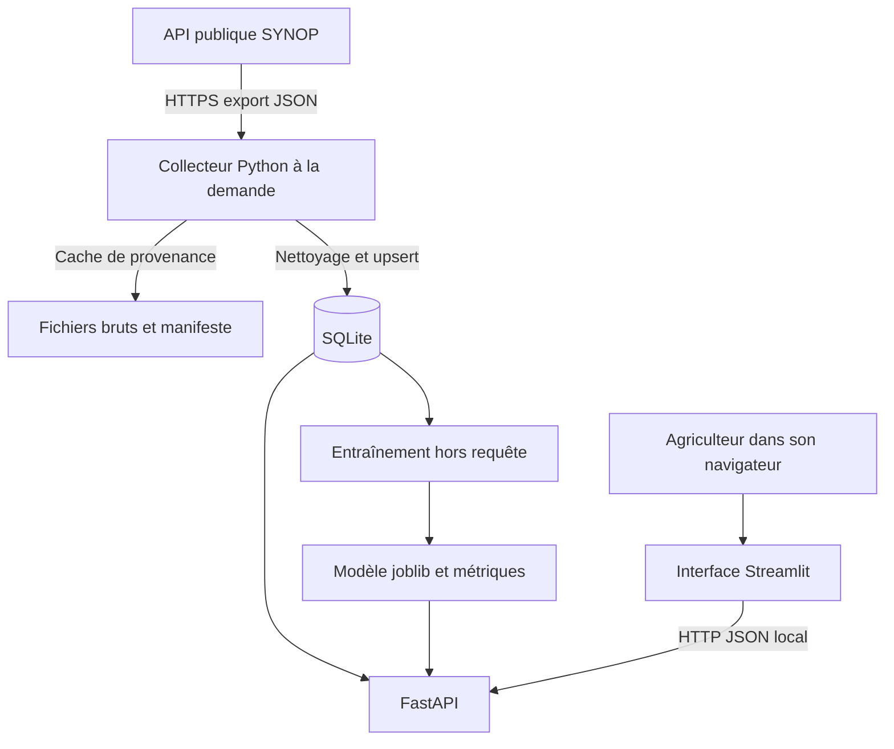
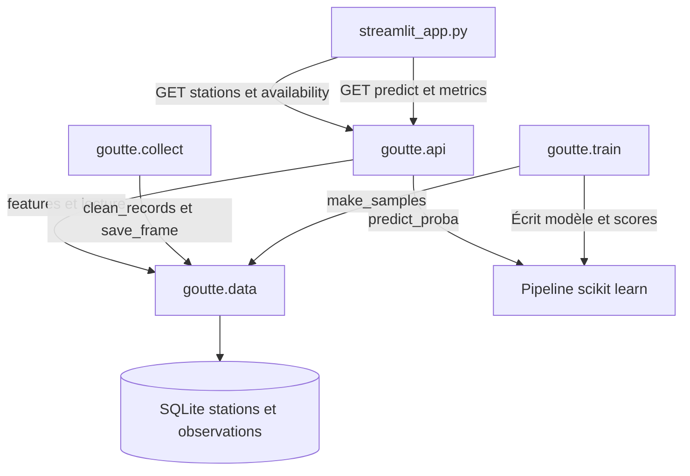

# Architecture et composants

## Architecture de déploiement du MVP

En production, seul le reverse proxy HTTPS est exposé ; API, base et entraînement restent privés. SQLite convient à ce prototype à faible concurrence. PostgreSQL est l’extension envisagée si plusieurs collecteurs ou réplicas écrivent simultanément. La collecte IoT directe n’est pas développée dans ce MVP : l’adaptateur d’observations pourra la recevoir à condition d’ajouter qualité, identité et horodatage de réception.

## Diagramme de composants

## Modèle de données

`stations(station_id PK, name, region)` est parent de `observations(station_id FK, day, observed_at, temperature_c, humidity_pct, pressure_hpa, wind_ms, rain_prev_mm)`. Clé primaire de l’observation : `(station_id, day)`. Une station a 0..N observations ; chaque observation appartient à une seule station. L’index sur `day` facilite les filtres temporels. Aucune donnée personnelle d’agriculteur n’est nécessaire.
